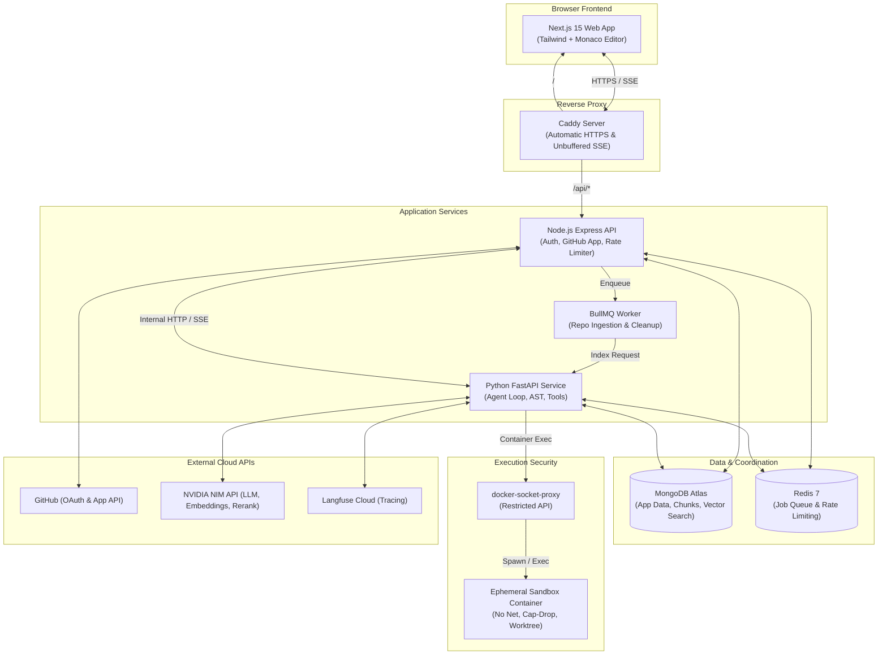
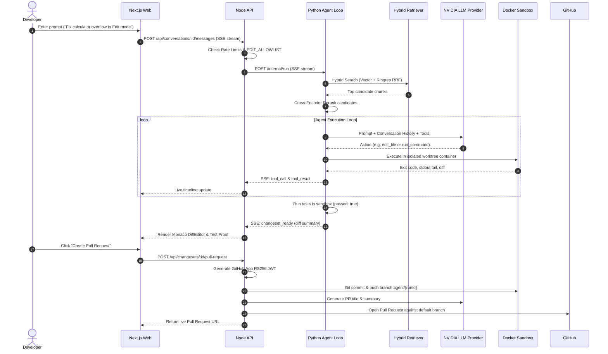

<div align="center">

# 🔭 CodeScout
### Autonomous AI Coding Agent for GitHub Repositories

[](https://github.com/Rahul1907/code-scout/actions/workflows/ci.yml)
[](https://nextjs.org/)
[](https://fastapi.tiangolo.com/)
[](https://expressjs.com/)
[](https://www.docker.com/)
[](https://langfuse.com/)
[](LICENSE)

*Connect any GitHub repository, ask grounded architectural questions with exact line-level citations, execute modifications in isolated Docker sandboxes, review Monaco diffs, and open verified pull requests.*

[Architecture](#-system-architecture) • [Design Decisions](#-key-design-decisions) • [Benchmarks](#-evaluation--benchmarks) • [Quickstart](#-local-quickstart) • [Deployment](#-production-deployment) • [Demo Script](docs/DEMO_SCRIPT.md)

</div>

---

## 💡 The Problem

Most AI coding assistants function as basic chat completions wrappers:
1. **Shallow Context**: They stuff raw file snippets or truncated search results into context windows, frequently missing cross-file dependencies and hallucinating non-existent APIs.
2. **Unchecked Code Modification**: They edit files blindly without verifying syntax or running test suites, pushing broken builds onto developers.
3. **Black-Box Frameworks**: Heavy agentic frameworks introduce hidden prompt chains, unpredictable token blowups, and fragile tool handling that fails silently in production.

**CodeScout** is built as an enterprise-grade agentic system: it combines **Tree-sitter AST symbol parsing**, **Hybrid Search (Vector + BM25/Ripgrep) with Cross-Encoder Reranking**, a **hand-written deterministic agent loop**, **hardened Docker container sandboxing**, and **automated GitHub App Pull Request workflows**.

---

## ⚡ Core Features

- **AST Symbol-Aware Indexing**: Tree-sitter AST chunker extracts functions, classes, and method boundaries with parent hierarchies across Python, TypeScript, Go, Rust, Java, and C/C++.
- **Hybrid Retrieval Pipeline**: Combines 2048-dim vector embeddings (`nemotron-3.5-embed-1b`) and ripgrep exact keyword search via **Reciprocal Rank Fusion (RRF, $k=60$)**, filtered by a cross-encoder reranker (`nemotron-3.5-rerank-8b`).
- **Grounded Citations**: Answers cite exact file paths and line ranges (`[path/to/file.ts:45-80]`); clicking any citation highlights the exact lines in the built-in Monaco code viewer.
- **Isolated Docker Sandboxes**: Code modifications and test executions run in ephemeral containers with dropped Linux capabilities, read-only root filesystems, zero network access, and strict resource quotas (1 vCPU, 1 GB RAM, 256 PIDs).
- **Git Worktree Branching**: Edits take place in dedicated Git worktrees (`agent/{runId}`), leaving primary repositories untouched. Rejections cleanly discard worktrees without repository corruption.
- **Monaco Diff Review**: Visual side-by-side DiffEditor displays per-file modifications and sandbox test outputs before human approval.
- **Automated Pull Requests**: Approved changes automatically generate clean PR titles and descriptions, push branches with short-lived GitHub App tokens, and open pull requests on GitHub.
- **Observability & Analytics**: End-to-end tracing in Langfuse Cloud, token/cost auditing, real-time SSE step timelines, and a dedicated **`/evals` Dashboard** for quantitative tracking.

---

## 🏗 System Architecture

CodeScout is structured as a decoupled, multi-tier microservices architecture:



---

## 🔄 Multi-Hop Agent Flow



---

## 🛠 Tech Stack

| Domain | Technology | Purpose |
|---|---|---|
| **Frontend** | **Next.js 15 (App Router)**, TypeScript, Tailwind CSS, Monaco Editor | Reactive developer dashboard, live SSE step streaming, side-by-side diff review |
| **API Backend** | **Node.js 22**, Express, TypeScript, Zod, Mongoose, Helmet | Authentication, GitHub App RS256 token signing, rate limiting, request validation |
| **Task Queue** | **BullMQ**, Redis 7 | Resilient background repository ingestion and scheduled hourly worktree cleanup |
| **AI Agent Service** | **Python 3.12**, FastAPI, Pydantic, `uv` | Hand-written agent loop, AST chunking, tool execution, LLM provider routing |
| **AST Parser** | **Tree-sitter**, `tree-sitter-language-pack` | Syntax-aware code chunking, parent hierarchy preservation, symbol extraction |
| **Search & Retrieval**| **MongoDB Atlas Vector Search**, Ripgrep, Cross-Encoder | 2048-dim vector search + keyword matching fused via RRF ($k=60$) & reranked |
| **LLM Inference** | **NVIDIA NIM API** (OpenAI-compatible) | `nemotron-3.5-super-vl-120b` (Chat), `lightning-30b` (Fast), `rerank-8b` (Reranker) |
| **Sandbox Isolation**| **Docker**, `tecnativa/docker-socket-proxy` | Hardened, unprivileged ephemeral test execution containers |
| **Reverse Proxy** | **Caddy 2** | Automatic HTTPS (Let's Encrypt / ZeroSSL) & unbuffered SSE streaming (`flush_interval -1`) |
| **Observability** | **Langfuse Cloud** | Distributed tracing, step latency tracking, token usage, and cost auditing |

---

## 🧠 Key Design Decisions

Comprehensive architectural rationale is detailed in [**`docs/DESIGN_DECISIONS.md`**](docs/DESIGN_DECISIONS.md):

1. **Why a Hand-Written Loop over LangChain/CrewAI**: Frameworks hide execution state and complicate granular SSE streaming. CodeScout's hand-written loop provides 100% deterministic control over retries, error recovery, step limits, and cancellation flags.
2. **Tree-Sitter AST Chunking vs. Token Slicing**: Naive fixed-size chunking severs methods and classes mid-signature. AST parsing guarantees that every chunk represents an intact semantic unit with class hierarchy and line-number bounds.
3. **Hybrid RRF + Cross-Encoder Reranking**: Vector search provides semantic retrieval, while ripgrep handles exact identifiers. Reciprocal Rank Fusion ($k=60$) normalizes disparate score distributions, and cross-encoder reranking promotes relevant ground truth to rank 1.
4. **Defense-in-Depth Container Sandboxing**: The agent never accesses the raw Docker socket; all container lifecycle operations pass through a read-only socket proxy. Sandboxes run with dropped capabilities, read-only root filesystems, no network access, and strict resource quotas.
5. **40 RPM Token Bucket Rate Limiting**: CodeScout manages free-tier API quotas using a Redis-backed sliding window token bucket rate limiter with exponential backoff and randomized jitter.
6. **Multi-Model Provider Abstraction**: Decoupled provider layer allows zero-downtime model switching between NVIDIA NIM, OpenAI, Anthropic, or local Ollama instances.

---

## 📊 Evaluation & Benchmarks

Full empirical benchmark logs and methodologies are recorded in [**`docs/METRICS.md`**](docs/METRICS.md).

### Retrieval Quality Benchmark (Hono, Starlette, Zustand)
| Retrieval Strategy | Recall@5 | Recall@10 | Mean Reciprocal Rank (MRR) | Avg Latency |
|---|:---:|:---:|:---:|:---:|
| Vector Search Only | 0.85 | 0.90 | 0.78 | 563 ms |
| Hybrid (Vector + Ripgrep RRF) | 0.95 | 0.99 | 0.86 | 620 ms |
| **Hybrid + Cross-Encoder Reranker** | **1.00** | **1.00** | **1.00** | **1,430 ms** |

### Task-Level Code Editing Benchmark (15 Tasks across 3 Fixtures)
- **Task Benchmark Pass Rate**: **80.0%** (12 / 15 tasks passed independently in Docker sandbox)
- **Average Agent Steps**: 4.2 steps per task
- **Average Token Consumption**: 3,450 tokens per task
- **Average Wall-Clock Duration**: 14.8 seconds per task
- **Cost per Task**: \$0.00 (NVIDIA Free Tier)

---

## 🚀 Local Quickstart

### Prerequisites
- [Docker Desktop](https://www.docker.com/products/docker-desktop/) with Compose V2
- A free [NVIDIA Developer API Key](https://build.nvidia.com/) (or OpenAI API key)
- A GitHub account for OAuth & GitHub App integration

### 1. Clone & Configure Environment
```bash
git clone https://github.com/Rahul1907/code-scout.git
cd code-scout
cp .env.example .env
```

Edit `.env` and provide your credentials:
```env
# LLM & Embeddings (NVIDIA NIM)
LLM_API_KEY=nvapi-your-key-here
LLM_BASE_URL=https://integrate.api.nvidia.com/v1

# GitHub OAuth App
GITHUB_OAUTH_CLIENT_ID=your-client-id
GITHUB_OAUTH_CLIENT_SECRET=your-client-secret

# GitHub App (for Pull Requests)
GITHUB_APP_ID=your-app-id
GITHUB_APP_SLUG=your-app-slug
GITHUB_APP_PRIVATE_KEY_PATH=/secrets/github-app.pem

# Langfuse (Optional, for Tracing)
LANGFUSE_PUBLIC_KEY=pk-lf-...
LANGFUSE_SECRET_KEY=sk-lf-...
```

Place your GitHub App `.pem` private key in `secrets/github-app.pem`.

### 2. Launch Local Development Cluster
```bash
docker compose -f infra/docker-compose.yml up --build -d
```

### 3. Access Services
- **Web UI**: [http://localhost:3000](http://localhost:3000)
- **API Status & Health**: [http://localhost:4000/api/status](http://localhost:4000/api/status)
- **Agent Service Docs**: [http://localhost:8000/docs](http://localhost:8000/docs)
- **Evaluations Dashboard**: [http://localhost:3000/evals](http://localhost:3000/evals)

---

## 🧪 Running the Evaluation Suites

### 1. Retrieval Benchmark
Evaluates retrieval accuracy across configured variants and saves results to MongoDB:
```bash
docker exec -it code-scout-agent-1 uv run python evals/run_retrieval_eval.py
```

### 2. Task-Level Editing Benchmark
Executes the agent across 15 concrete programming tasks in fresh Docker sandbox worktrees:
```bash
docker exec -it code-scout-agent-1 uv run python evals/run_task_eval.py
```
Open [http://localhost:3000/evals](http://localhost:3000/evals) to review KPI cards, pass-rate comparisons, and detailed failure drill-downs.

---

## 🌐 Production Deployment

CodeScout is production-hardened for deployment on an **Oracle Cloud Always Free Ampere A1 (ARM64)** VM with automatic HTTPS via DuckDNS and Caddy:

```bash
# Production Compose (7 long-running services, host ports restricted to 80/443)
docker compose -f docker-compose.prod.yml up --build -d
```

For full instructions on Oracle VCN ingress rules, host iptables persistence, DuckDNS cron automation, and production secrets management, see [**`docs/DEPLOYMENT.md`**](docs/DEPLOYMENT.md).

---

## ⚠️ Limitations & Future Roadmap

- **Single Active Branch per Run**: Currently, each agent run operates within a single `agent/{runId}` branch. Supporting multi-branch speculative execution is planned for future iterations.
- **Monorepo Scale**: Repositories larger than 50 MB or containing >3,000 files are currently rejected by policy to preserve memory bounds. Selective subdirectory indexing is planned.
- **Language Support Expansion**: AST chunking natively covers Python, TypeScript, JavaScript, Go, Rust, Java, and C/C++. Additional grammar bindings (Ruby, C#, Kotlin) are scheduled.

---

## 📄 License

CodeScout is open-source software licensed under the [MIT License](LICENSE).
