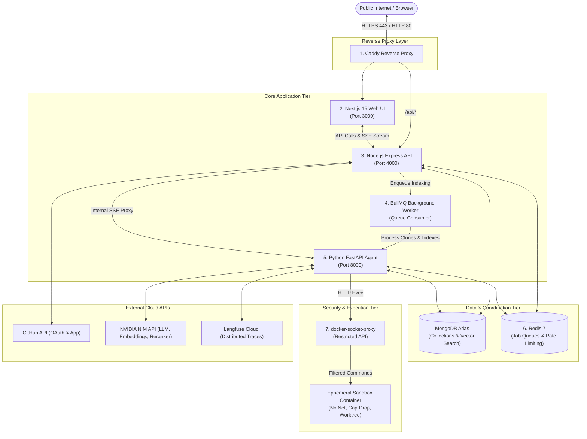
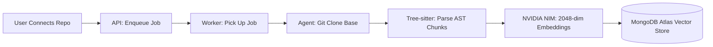

# 🔭 CodeScout: Complete System Architecture & Infrastructure Guide

**CodeScout** is an autonomous AI coding agent designed to interact with real GitHub repositories. Unlike simple chat wrappers, it understands repository syntax via AST parsing, runs tools in a deterministic agent loop, tests changes inside isolated Docker sandboxes, and automates pull requests via GitHub Apps.

---

## 1. High-Level Infrastructure Topology

The production setup runs **7 containerized services** on an isolated internal Docker bridge network. Only **Caddy** exposes ports `80` and `443` to the public internet:



---

## 2. Service-by-Service Breakdown

| # | Service | Tech Stack | Internal Port | Public? | Purpose & Responsibilities |
|---|---|---|:---:|:---:|---|
| **1** | **`caddy`** | Caddy 2 (Alpine) | `80`, `443` | **Yes** | Automatic HTTPS (Let's Encrypt / ZeroSSL), reverse proxy to Next.js (`/`) and Express (`/api/*`), with `flush_interval -1` for unbuffered Server-Sent Events (SSE). |
| **2** | **`web`** | Next.js 15, React 19, Tailwind | `3000` | No | Responsive UI: repository manager, chat with collapsible agent steps timeline, Monaco DiffEditor for diff reviews, and `/evals` analytics dashboard. |
| **3** | **`api`** | Node.js 22, Express, TypeScript | `4000` | No | User auth (GitHub OAuth), session cookies, rate limiting (per IP/user), GitHub App RS256 JWT signing, PR routes, and SSE streaming proxy. |
| **4** | **`worker`** | Node.js 22, BullMQ, Redis | N/A | No | Async background queue worker: triggers repository cloning & indexing, and runs scheduled hourly cleanup of stale worktrees (>24h). |
| **5** | **`agent`** | Python 3.12, FastAPI, `uv` | `8000` | No | The core brain: hand-written agent loop, Tree-sitter AST chunker, hybrid vector+keyword retriever, and sandbox container lifecycle manager. |
| **6** | **`redis`** | Redis 7 Alpine | `6379` | No | Task queue broker for BullMQ, sliding-window rate limiting, and agent run cancellation flags. |
| **7** | **`docker-socket-proxy`** | HAProxy Docker Proxy | `2375` | No | Security barrier: allows the Agent to manage sandbox containers without granting access to the raw Docker socket or host root filesystem. |
| **-** | **`sandbox`** | Node 20 + Python 3 + Git | Ephemeral | No | Short-lived, unprivileged container spawned per Edit run to execute commands and test suites safely. |

---

## 3. End-to-End Workflow: How the System Works

### 1. Repository Ingestion & AST Indexing Pipeline
When a user connects a GitHub repository:
1. **Queueing**: The API creates a `Repo` document in MongoDB and enqueues an `index-repo` job in Redis via BullMQ.
2. **Cloning**: The `worker` picks up the job and requests the Python `agent` service to clone the repo into `/data/repos/{repoId}/base`.
3. **Tree-sitter AST Chunking**: Instead of naive character chunking, CodeScout uses **Tree-sitter** grammar parsers (`services/agent/app/indexing/ast_chunker.py`) across Python, TypeScript, Go, Rust, Java, etc. It identifies functions, classes, and methods as intact semantic units, extracting symbol names and parent hierarchies (e.g., `Class > Method`).
4. **Vector Embeddings**: Chunks are batched (16 at a time) and sent to NVIDIA's `nemotron-3.5-embed-1b` model to generate 2048-dimensional embeddings.
5. **Storage**: Chunks, metadata, and embeddings are stored in MongoDB Atlas with a Vector Search index.



---

### 2. "Ask" Mode: Grounded Codebase Q&A
When a developer asks a question (e.g., *"How does authentication work?"*):
1. **Hybrid Retrieval**:
   - **Semantic Search**: Generates embedding of the query and finds top 30 chunks via MongoDB Vector Search.
   - **Verbatim Keyword Search**: Runs `ripgrep` across source files to find exact identifier matches.
   - **Reciprocal Rank Fusion (RRF)**: Merges vector and keyword results using $RRF(d) = \sum \frac{1}{60 + r(d)}$.
2. **Cross-Encoder Reranking**: The top 30 fused candidates are scored by `nemotron-3.5-rerank-8b`. This eliminates false positives and elevates the exact ground-truth file to rank 1.
3. **Agent Loop & SSE Streaming**: The agent loop yields tokens and step events in real time through Server-Sent Events (SSE).
4. **Clickable Citations**: Line ranges (`[src/auth.ts:15-45]`) are parsed and rendered as clickable tags; clicking them navigates the Monaco code viewer directly to those lines.

---

### 3. "Edit" Mode: Sandboxed Code Modification & Verification
When the user asks CodeScout to fix a bug or implement a feature:
1. **Git Worktree Branching**: The agent never edits the base repo. It creates an isolated Git worktree:
   ```text
   /data/repos/{repoId}/runs/{runId}  ->  branch: agent/{runId}
   ```
2. **Ephemeral Sandbox Spawning**: The agent calls `docker-socket-proxy` to launch an isolated container:
   - Root filesystem: **Read-Only** (only `/workspace` and `/tmp` are writable).
   - Linux capabilities: **All dropped** (`--cap-drop ALL`, `no-new-privileges: true`).
   - Network access: **Disabled by default** (`--network none`).
   - Resource limits: **1 vCPU**, **1 GB RAM**, **256 PIDs** (blocks fork bombs).
3. **Iterative Tool Execution**: The agent reads files, applies targeted string replacements via `edit_file`, and runs test commands via `run_command` in the sandbox. It can iterate up to 3 times if tests fail.
4. **Changeset Generation**: Upon test success, it captures `git diff` and packages a `Changeset` record.
5. **Monaco Diff Review**: The web UI automatically switches to the **Changeset View**, displaying a side-by-side Monaco DiffEditor with the test output proof.

```mermaid
sequenceDiagram
    autonumber
    actor Dev as Developer
    participant Agent as Python Agent Loop
    participant Proxy as docker-socket-proxy
    participant Box as Ephemeral Sandbox
    participant UI as Monaco Diff UI

    Dev->>Agent: "Fix bug in calculator and run tests"
    Agent->>Agent: Create Git Worktree (agent/run-123)
    Agent->>Proxy: Launch Sandbox (No Net, Cap-Drop)
    Proxy->>Box: Start Container with /workspace mount
    Agent->>Box: Exec: edit_file(calculator.ts)
    Agent->>Box: Exec: run_command("npm test")
    Box-->>Agent: Exit Code 0, All tests pass!
    Agent->>Agent: Generate Git Diff
    Agent-->>UI: Display Monaco DiffEditor & Test Pass Proof
```

---

### 4. Pull Request Automation via GitHub App
When the developer clicks **"Create Pull Request"**:
1. **GitHub App JWT**: The Node API generates an RS256 signed JWT using your App ID and private key (`github-app.pem`).
2. **Short-Lived Installation Token**: It requests a 1-hour installation token from GitHub on demand (tokens are never stored in the database).
3. **Commit & Push**: The agent commits the worktree changes with a standardized committer identity (`CodeScout Agent <agent@codescout.dev>`) and pushes branch `agent/{runId}` to GitHub using the token.
4. **PR Body Generation**: `LLM_FAST_MODEL` generates a structured markdown PR body containing:
   - Summary of the problem and fix
   - List of modified files
   - Test execution verification command and exit code
   - Link back to the agent run ID
5. **Pull Request Opened**: The PR is opened against the repository's default branch (`master`/`main`), and the live PR link is displayed in the UI.

---

### 5. Production Hardening & Operations
* **Rate Limiting**: `rateLimiter.ts` middleware enforces 120 reqs/min per IP and 60 reqs/min per user, preventing abuse.
* **Public Demo Protection**: `EDIT_ALLOWLIST=Rahul1907` ensures only your authorized GitHub account can run Edit mode or open pull requests; all other visitors can explore in Ask mode.
* **Caddy Reverse Proxy**: Automatically manages SSL/TLS certificates via Let's Encrypt and routes traffic without buffering SSE streams (`flush_interval -1`).
* **Self-Maintenance**: The BullMQ worker runs hourly background cleanups to delete worktree directories older than 24 hours, preventing disk exhaustion and keeping the Oracle VM active.
* **Status Monitoring**: `/api/status` provides live health checks and ping latencies for MongoDB, Redis, the Agent service, and NVIDIA LLM availability.

---

### Summary Checklist of What You Built

1. **Full-Stack Application**: Next.js 15 (React 19) + Express API + Python FastAPI.
2. **Advanced Information Retrieval**: Tree-sitter AST syntax chunking + Vector Search + Ripgrep keyword search + Reciprocal Rank Fusion + Cross-Encoder Reranker (**1.00 MRR** on benchmarks).
3. **Autonomous Agent Loop**: Hand-written loop with real-time SSE streaming, tool schema validation, and automatic syntax error recovery.
4. **Isolated Docker Sandbox**: Ephemeral execution containers with dropped Linux capabilities, read-only root filesystems, and Git worktree isolation.
5. **GitHub App Integration**: RS256 JWT signing, short-lived tokens, worktree branch push, and automated PR generation.
6. **Production Deployment**: Oracle Cloud Always Free VM, Caddy automatic HTTPS, DuckDNS dynamic DNS, rate limiting, and multi-arch Docker Compose.
