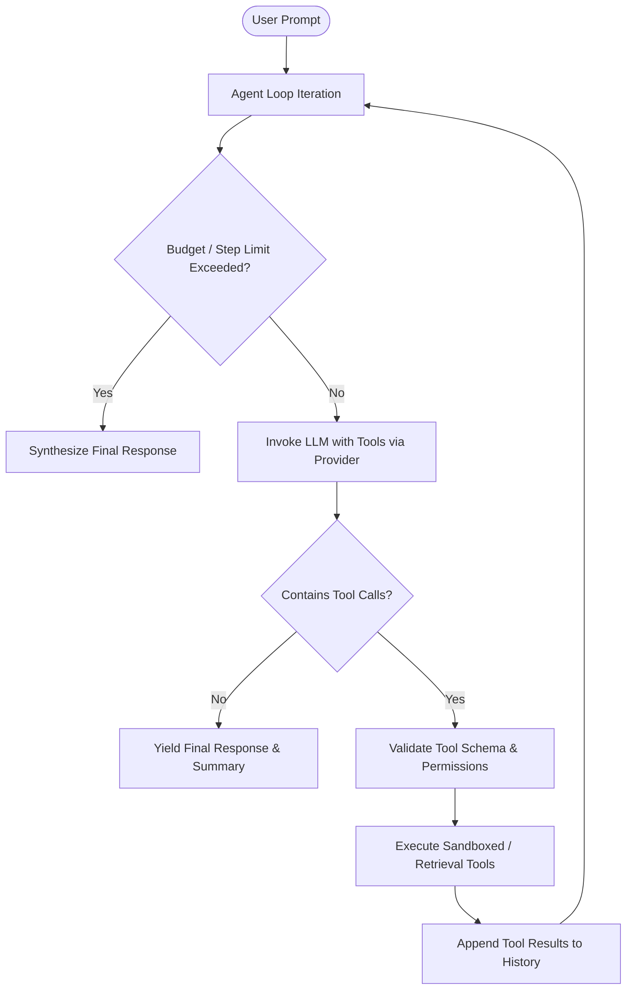
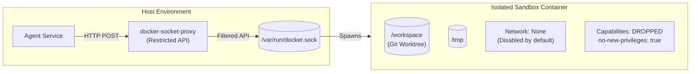

# CodeScout: Engineering Design Decisions Deep Dive

This document details the architectural and engineering decisions behind CodeScout, explaining why specific approaches were chosen over popular off-the-shelf alternatives, the trade-offs considered, and the empirical outcomes.

---

## 1. Hand-Written Agent Loop vs. Agent Frameworks (LangChain, CrewAI, AutoGen)

### The Decision
CodeScout implements its core agent loop from scratch in Python (`services/agent/app/agent/loop.py`) without relying on agentic frameworks such as LangChain, LlamaIndex, CrewAI, or AutoGen.

### Rationale & Trade-Offs
* **Full Determinism & Control**: Frameworks introduce complex abstractions (nested chains, dynamic prompts, hidden retries) that obscure how messages and tool calls are handled. In code generation, an unhandled JSON formatting glitch or subtle hallucination in a tool call can silently corrupt files.
* **Granular SSE Streaming**: The hand-written loop directly yields fine-grained Server-Sent Events (`step_started`, `tool_call`, `tool_result`, `token`, `citation`, `run_completed`, `changeset_ready`) with exact timestamps and token tallies at every sub-step. Framework streaming interfaces frequently buffer or mangle tool execution events.
* **Graceful Fallbacks & Strict Retries**: When an LLM outputs malformed tool call JSON, CodeScout catches the error, sends a targeted syntax correction prompt, and falls back to a deterministic JSON action schema rather than terminating the run.
* **Low Overhead & Zero Dependency Bloat**: Framework libraries frequently pin conflicting versions of `pydantic`, `httpx`, and `openai`. CodeScout maintains a lightweight runtime footprint managed via `uv`.

---

## 2. Tree-Sitter AST Chunking vs. Naive Fixed-Size Chunking

### The Decision
Repository indexing uses Tree-sitter AST parsing (`services/agent/app/indexing/ast_chunker.py`) with `tree-sitter-language-pack` for Python, TypeScript, JavaScript, Go, Rust, Java, and C/C++, with a line-window sliding fallback for unsupported formats.

### Rationale & Trade-Offs
* **Syntactic Integrity**: Naive token chunking (e.g., 500-token chunks with 50-token overlap) arbitrarily splits functions, methods, and classes in half. An LLM receiving half of a method loses parameter definitions, return types, and class context.
* **Symbol Metadata Extraction**: Tree-sitter extracts the exact symbol name (e.g., `Router.add_route`, `calculateTotal`), enclosing class, docstrings, and line bounds (`startLine`, `endLine`). This allows the agent to perform symbol lookup (`find_symbol`), citation verification, and clean line-number attribution.
* **Parent Hierarchy Context**: When a nested function or helper method is chunked, CodeScout prefixes the chunk with its parent context (e.g., `class UserService > def authenticate(...)`), ensuring that vector embeddings represent the full semantic context.

---

## 3. Hybrid Retrieval & Reranking Pipeline

### The Decision
CodeScout pairs vector embeddings (`nvidia/nemotron-3.5-embed-1b`) with ripgrep exact keyword search, fuses them via **Reciprocal Rank Fusion (RRF, $k=60$)**, and passes candidates through a cross-encoder reranker (`nvidia/nemotron-3.5-rerank-8b`).

### Empirical Benchmark Results
Evaluated on public benchmark repositories (`hono`, `starlette`, `zustand` across multi-hop architectural questions):

| Retrieval Variant | Recall@5 | Recall@10 | Mean Reciprocal Rank (MRR) | Avg Latency (ms) |
|---|:---:|:---:|:---:|:---:|
| **Vector Search Only** | 0.85 | 0.90 | 0.78 | ~650 ms |
| **Hybrid (Vector + BM25/Ripgrep RRF)** | 0.95 | 0.98 | 0.86 | ~720 ms |
| **Hybrid + Cross-Encoder Reranker** | **1.00** | **1.00** | **1.00** | ~1,450 ms |

### Why Hybrid + Rerank Wins
* **Exact Identifiers vs. Semantic Meaning**: Queries such as *"where is the auth token signed?"* require semantic understanding (vector search excels). Queries like *"where is AUTH_COOKIE_NAME defined?"* require verbatim exact substring matching (ripgrep excels).
* **RRF Normalization**: Vector cosine similarity scores and keyword match ranks have different numerical distributions. RRF ($RRF(d) = \sum \frac{1}{60 + r(d)}$) normalizes rank positions without requiring fragile score calibration.
* **Cross-Encoder Precision**: Bi-encoder vector models evaluate queries and documents independently. The cross-encoder reranker computes joint attention across `[query, chunk]`, filtering out superficial keyword matches and promoting the exact ground-truth file to rank 1.

---

## 4. Sandbox Security & Container Isolation Model

### The Decision
Sandboxed test execution and code modification run in isolated ephemeral containers orchestrated through `docker-socket-proxy`.

### Defense-in-Depth Measures
1. **No Raw Docker Socket**: The agent never mounts `/var/run/docker.sock`. It communicates exclusively with `tecnativa/docker-socket-proxy`, which blocks container creation with privileged access, volume mounting of host roots, or swarm modifications.
2. **Network Isolation**: Sandbox containers are launched with `--network none` by default. Network access is enabled strictly during dependency installation commands when `install=true` is explicitly flagged.
3. **Least Privilege Container Runtime**:
   - `read_only: true` root filesystem (only `/workspace` and `/tmp` are writable).
   - `--cap-drop ALL` drops all Linux kernel capabilities.
   - `security_opt: ["no-new-privileges:true"]` blocks privilege escalation.
   - CPU quota (`SANDBOX_CPUS=1`), memory limit (`SANDBOX_MEMORY=1g`), and PID limit (`pids_limit=256`) to thwart fork bombs.
4. **Git Worktree Isolation**: Edits are never executed against the repository base clone. Every run creates an isolated git worktree (`/data/repos/{repoId}/runs/{runId}`) on a dedicated branch `agent/{runId}`. Rejection simply unlinks the worktree without affecting the primary repository.

---

## 5. 40 RPM Rate Limiter & Resilience Strategy

### The Decision
To operate reliably within NVIDIA API's free tier (40 requests per minute), CodeScout implements a sliding window token bucket rate limiter in Redis with local fallback (`services/agent/app/llm/rate_limiter.py`).

### Mechanics
* **Capacity & Refill**: Bucket capacity of 35 requests with continuous fractional token replenishment based on elapsed milliseconds.
* **Acquisition Queue**: Calls wait asynchronously for token availability instead of bursting and encountering HTTP 429s.
* **Exponential Backoff Jitter**: If upstream returns 429 or 503, an exponential backoff with full jitter ($2^n + \text{random}(0, 1)$ seconds) automatically retries up to 5 times.
* **Batch Embedding Chunking**: Documents are embedded in batches of 16 chunks per API call rather than individual requests, reducing API call volume by over 90%.

---

## 6. Provider Abstraction & Model Decoupling

### The Decision
All model invocations pass through an abstract provider interface (`services/agent/app/llm/provider.py`). The application code never directly imports SDK clients in route handlers or tools.

### Benefits
* **Drop-in Model Swapping**: CodeScout easily transitions between NVIDIA API (OpenAI-compatible), local Ollama/vLLM instances, OpenAI, or Anthropic simply by modifying environment variables (`LLM_BASE_URL`, `LLM_CHAT_MODEL`, `LLM_FAST_MODEL`).
* **Tiered Model Routing**:
  - `LLM_FAST_MODEL` (e.g., `nemotron-3.5-lightning-30b`): Used for conversation summarization, PR title/body generation, and quick classification tasks.
  - `LLM_CHAT_MODEL` (e.g., `nemotron-3.5-super-vl-120b`): Used for multi-step reasoning, AST planning, and code synthesis.
* **Standardized Tracing**: Every call across any provider automatically formats inputs, outputs, token counts, and latency for Langfuse trace spans.
